<p align="center">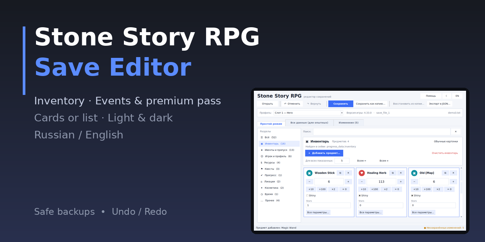</p>

<p align="center">
  
  
  
  
</p>

# Stone Story RPG Save Editor

🇷🇺 [Читать по-русски](README_RU.md)

A friendly, safe save editor for **Stone Story RPG**. It decrypts your save, shows every value as an easy card
(or as a classic list), lets you change it, then encrypts and verifies the file again.
No programming knowledge needed.

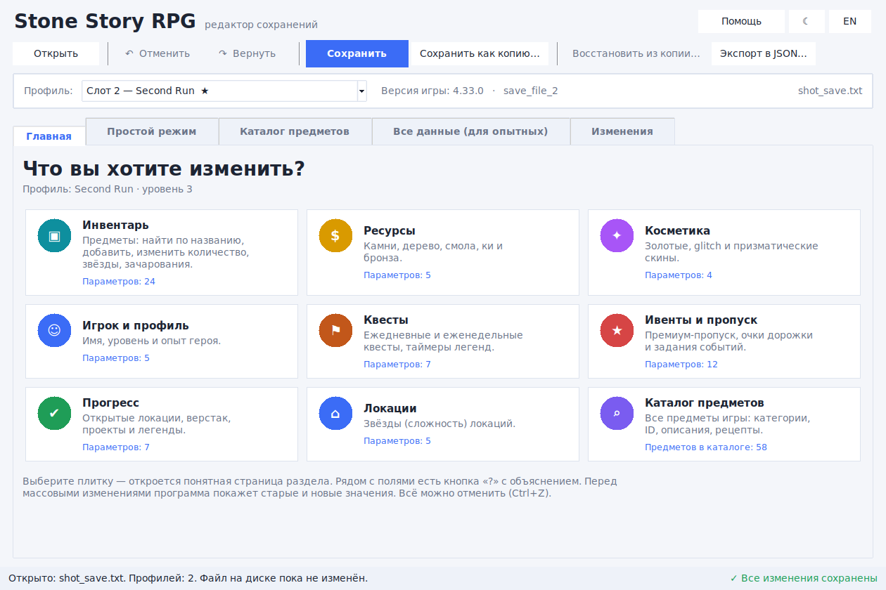
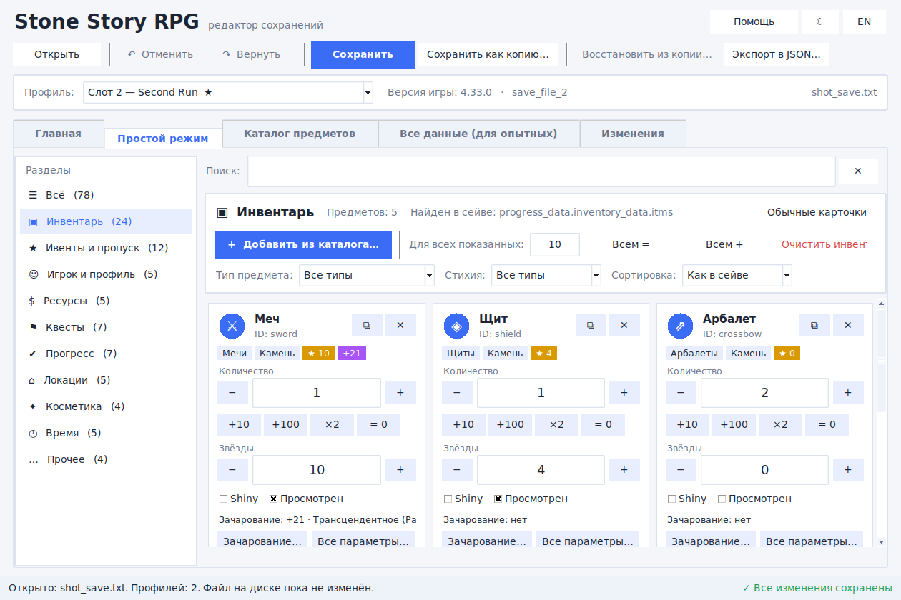
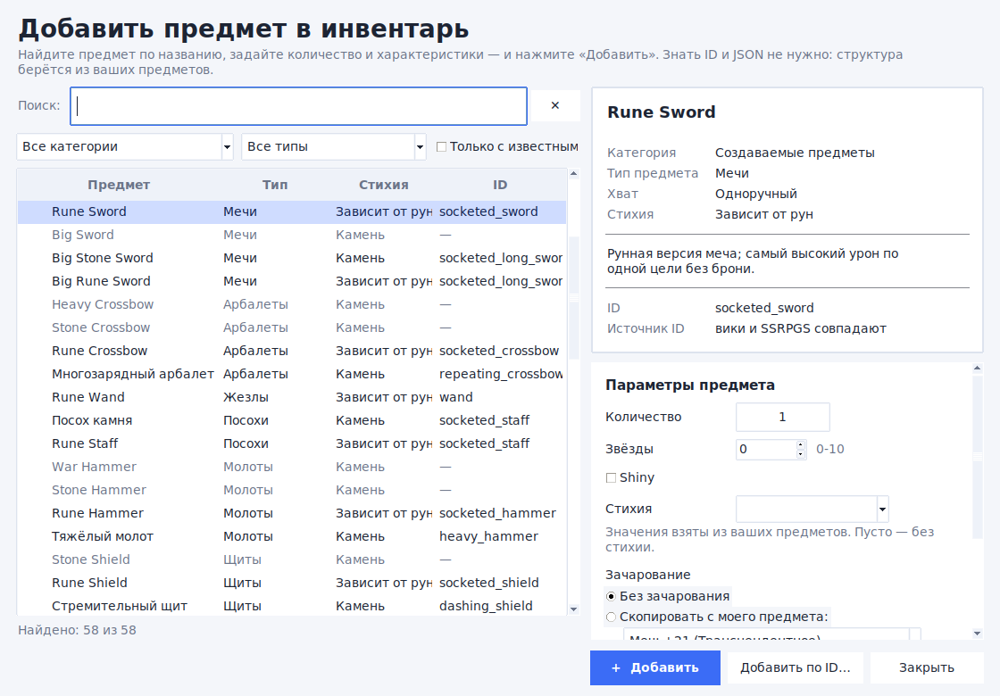

<details>
<summary>More screenshots (cards, dark theme, list view, welcome screen)</summary>

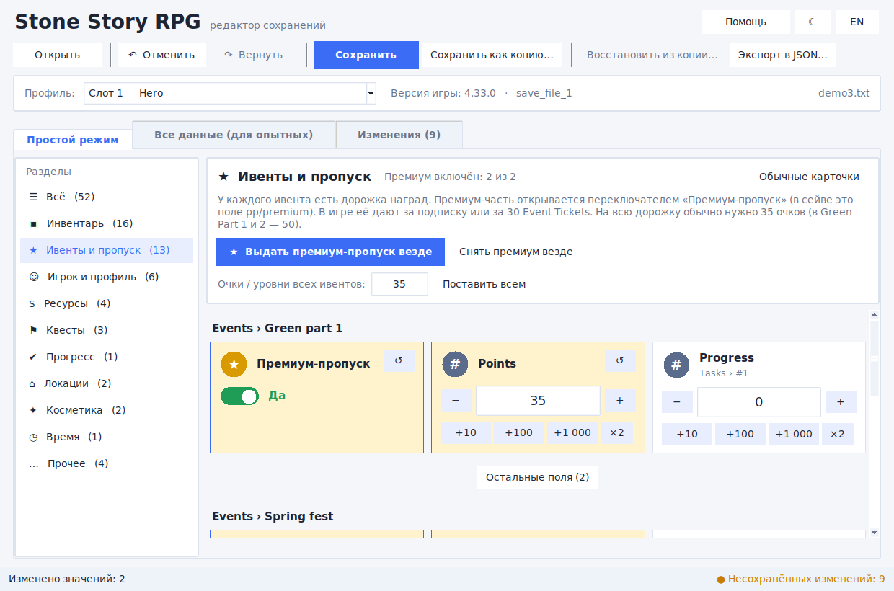
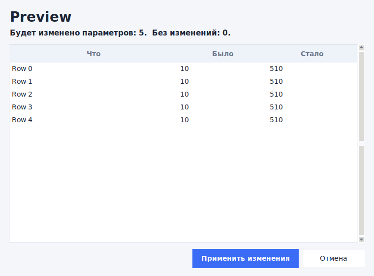
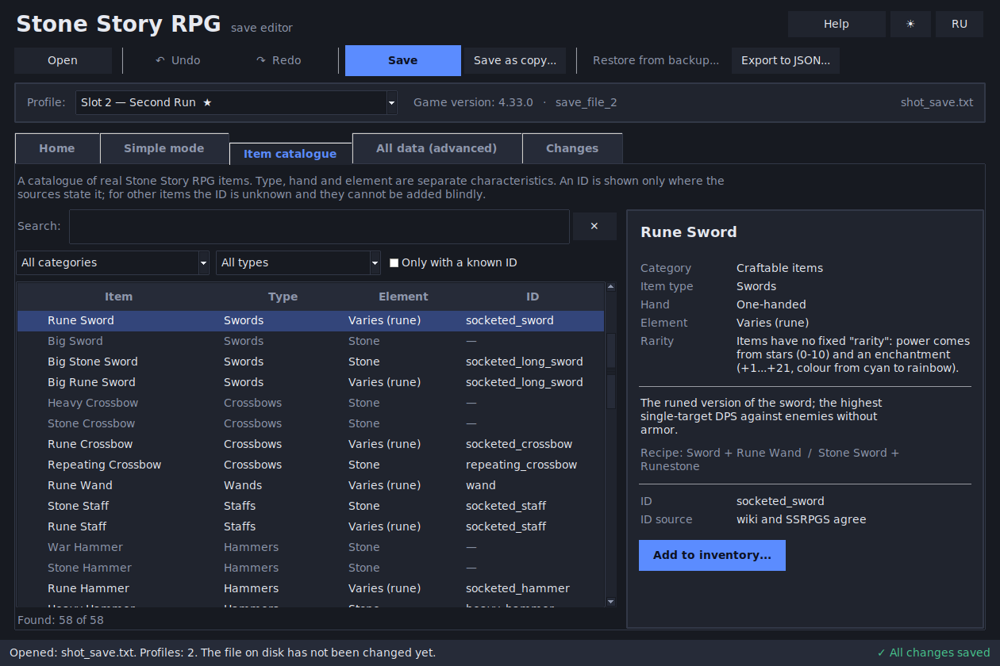
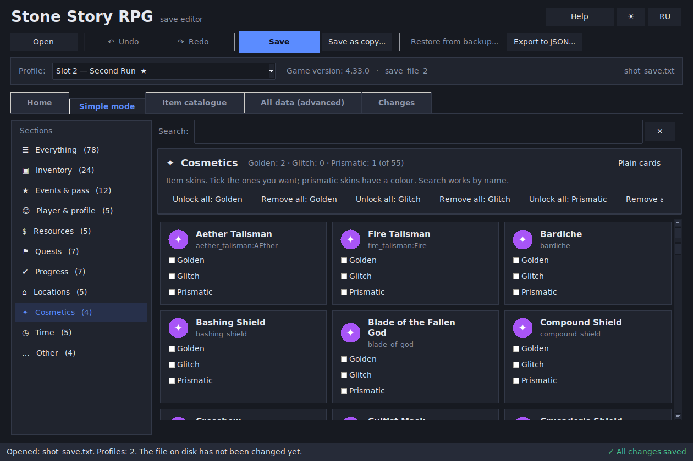
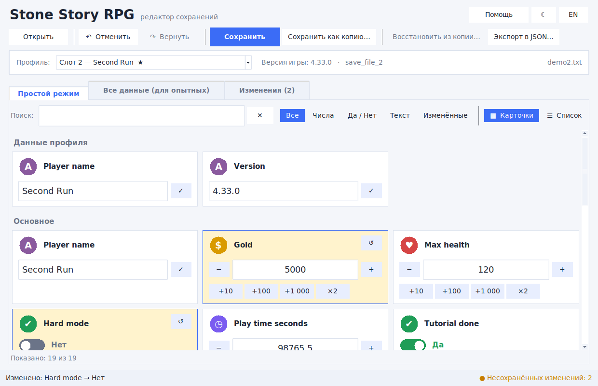
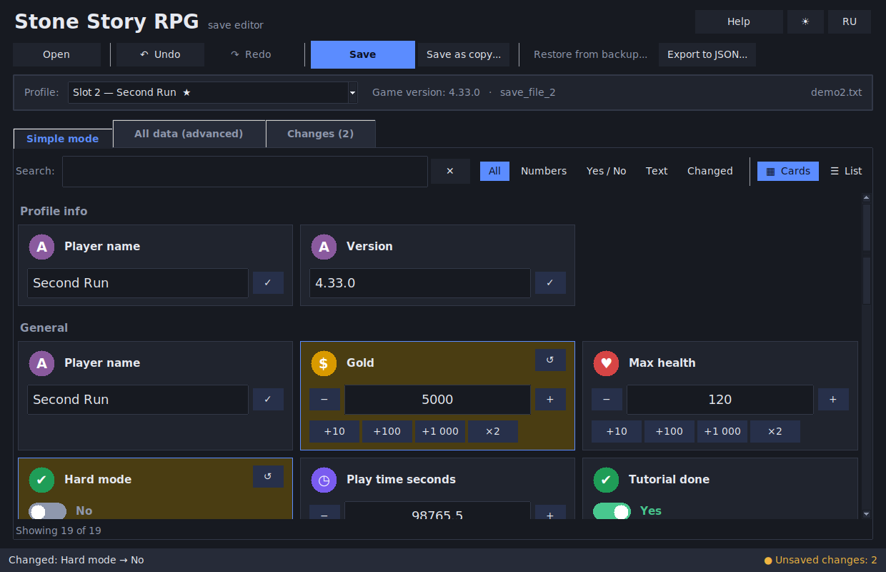
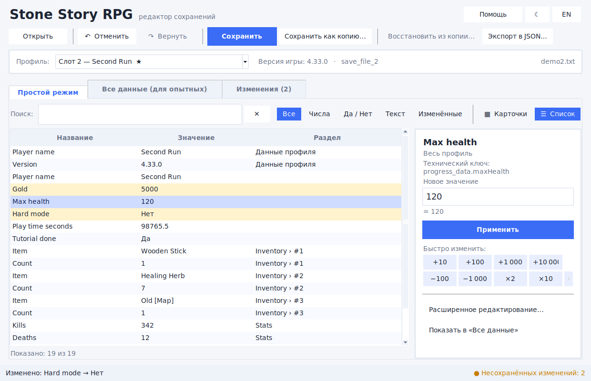
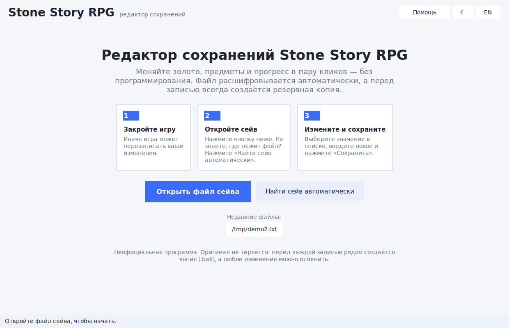

*Screenshots use a fake demo save with invented data.*
</details>

## Features

- **Home screen** – nine tiles: Inventory, Resources, Cosmetics, Player, Quests, Events, Progress, Locations and the Item catalogue.
- **Item catalogue** – search real Stone Story RPG items by name with categories, subcategories, IDs, descriptions and recipes. Type, hand, element, stars and enchantment are **separate** characteristics.
- **Add items without JSON** – pick an item by name, set amount, stars, shiny, element and enchantment; the structure is copied from your own items. Items whose ID is not in the sources cannot be added blindly.
- **Explanations** – a "?" next to game parameters (Level, XP, Shiny, Enchantments, Lost items, Premium pass ...). Unknown fields are never guessed.
- **Change preview** – before any bulk edit you see old and new values and how many parameters are affected.
- **Sections** – Inventory, Events & pass, Player, Resources, Quests, Progress, Locations, Cosmetics, Time, Other. Pick a section and see only its values.
- **Inventory manager** – a card per item: amount (`−` / `+`, quick `+10`, `+100`, `×2`), tick boxes (e.g. *shiny*), stars/enchant fields, add / duplicate / delete items, change the amount of all shown items at once, clear the inventory.
- **Events & premium pass** – a *Premium pass* switch (the `pp` field) for every event, one-click **Give premium pass everywhere**, points/levels of the reward track for all events at once.
- **Cards view** – each value is a card with an icon, `−` / `+` buttons, quick-add chips (`+10`, `+100`, `×2`) and Yes/No switches.
- **List view** – a table of all values with an edit panel; select several numbers and change them at once.
- **Search & filters** – numbers, Yes/No, text, "changed only".
- **Safe by design** – a dated `.bak` backup before every save, the result is decrypted again and compared, and the file is written atomically. If verification fails, nothing is written.
- **Undo / Redo**, a **Changes** tab with per-change restore, "Restore from backup".
- **Find my save automatically**, recent files.
- **Light and dark themes**, **Russian and English** interface.
- *All data (advanced)* tab: the full tree, add/delete fields, edit raw JSON.

## Quick start (Windows)

1. Install [Python 3.10+](https://www.python.org/downloads/) – tick **"Add Python to PATH"**.
2. Download this repository (green **Code → Download ZIP**) and unpack it.
3. Double-click **`start.bat`**. The first start installs one small library (internet needed once).
4. Close the game, click **Open save file** (or **Find my save automatically**), edit, click **Save**.

Prefer no Python? Download `StoneStorySaveEditor.exe` from the **Releases** page (built by GitHub Actions).

### Linux / macOS

```bash
# Linux only: sudo apt install python3-tk
./start.sh
```

### From source

```bash
pip install -r requirements.txt
python -m stone_story_editor [path/to/save.txt]
```

## Where is my save file?

Use **Find my save automatically**. According to the game's official FAQ the file is `primary_save.txt` in:

- Windows: `C:\Users\<you>\AppData\LocalLow\Martian Rex, Inc_\Stone Story\<steam id>\`
- macOS: `~/Library/Application Support/Martian Rex, Inc_/Stone Story/<steam id>/`
- Linux: `<Steam install>/Stone Story RPG/saves/<steam id>/`

The game also keeps `backup.txt` and `historical_#` files there.

## Data accuracy

The catalogue, names and hints use only published sources (game FAQ, community wiki, the save layout documented by the
SSRPGS project). IDs are shown with their source; unknown IDs stay unknown. Details: [docs/DATA_SOURCES.md](docs/DATA_SOURCES.md).

## About the sections

The save's field names are not officially documented, so sections are detected from **key words**
(`inventory`, `event`, `pp`, `premium`, `quest` ...). Nothing is hidden: unrecognised values land in *Other*, and the
**Plain cards** button on the Inventory / Events pages shows every value of the section.
If the game uses a word the editor does not know, add it to the `RULES` table at the top of
`stone_story_editor/sections.py` (pull requests with real key names are very welcome!).

## Important

- **Close the game** before saving, otherwise it may overwrite your changes.
- Only the local file is changed. Purchases, subscriptions and server-verified data are not granted.
- Huge numbers (over ~2 billion) may break the game; the editor warns you.
- Keep your `.bak` files until you are sure the game loads the edited save.
- Unofficial tool, **use at your own risk**. Not affiliated with the game's developers.
- Works with the current version of the game (tested on the latest Steam release). If a future update changes the save encryption, the editor will need an update.
- `pprp` is pinned to **0.2.6** on purpose – do not upgrade to 0.2.7.

## Development

```bash
pip install -r requirements-dev.txt
python -m pytest            # unit tests (parser, encryption, undo/redo, i18n)
python tests/sample_save.py demo_save.txt   # fake save to try the editor
build_exe.bat               # Windows: build dist/StoneStorySaveEditor.exe
```

Project layout:

| File | Purpose |
|------|---------|
| `stone_story_editor/core.py` | parser, encryption, safe saving, diff, undo/redo (no GUI) |
| `stone_story_editor/gui.py` | tkinter interface (sections sidebar, cards, list, tree, changes) |
| `stone_story_editor/views.py` | inventory manager and events / premium pass view |
| `stone_story_editor/sections.py` | key-word based section detection (no GUI) |
| `stone_story_editor/catalog.py`, `catalog_ui.py` | item catalogue, search, add-item wizard |
| `stone_story_editor/knowledge.py`, `knowledge_data.py` | real names and explanations of fields |
| `stone_story_editor/pages.py`, `ops.py` | section pages and undoable list edits |
| `stone_story_editor/cards.py` | value cards (icon, +/- buttons, switches) |
| `stone_story_editor/i18n.py` | Russian / English texts and help |
| `stone_story_editor/theme.py` | light / dark palettes |
| `stone_story_editor/finder.py` | automatic save search |
| `tests/` | tests and the fake demo save generator |

To publish releases: push a tag such as `v2.0.0`; the workflow in `.github/workflows/release.yml` attaches the `.exe`.

## Credits & license

The save layout and game names were studied from the [SSRPGS](https://github.com/Catalyst-42/SSRPGS) project (reference only, no code copied) and the community wiki.

Encryption parameters follow the publicly documented save format (SSRPGS cryptor). Uses
[`pprp`](https://pypi.org/project/pprp/) for Rijndael-256. Released under the [MIT License](LICENSE).
