<p align="center">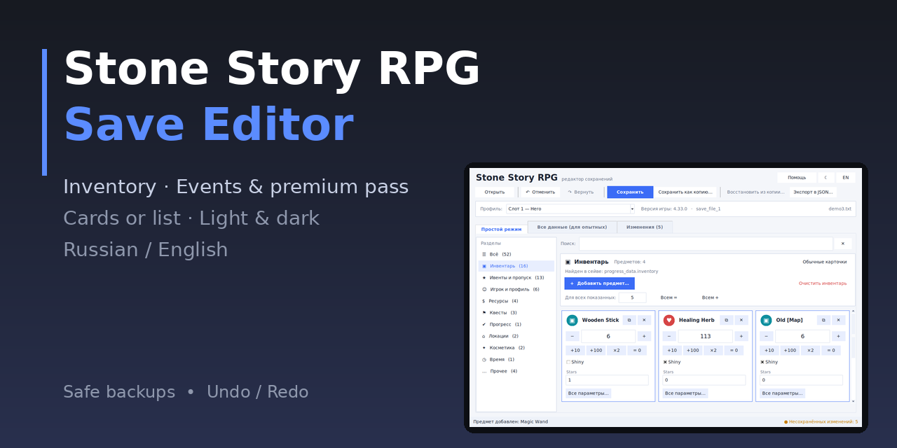</p>

<p align="center">
  
  
  
  
</p>

# Редактор сохранений Stone Story RPG

🇬🇧 [English version](README.md)

Удобный и безопасный редактор сохранений **Stone Story RPG**. Он расшифровывает сейв, показывает все значения
в виде понятных карточек (или обычного списка), даёт их изменить, а потом снова шифрует и проверяет файл.
Разбираться в программировании не нужно.

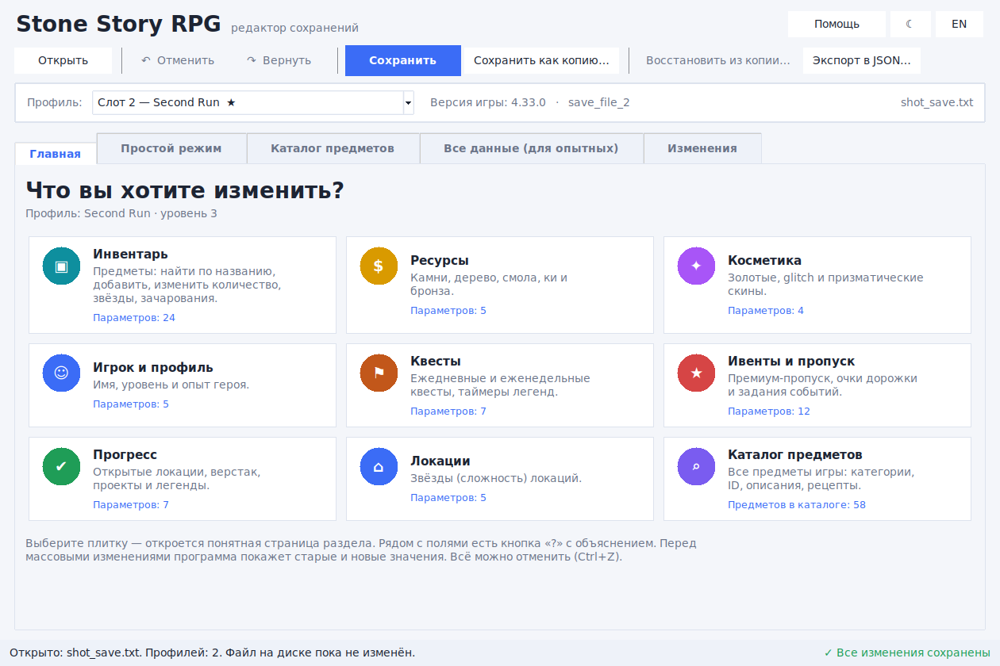
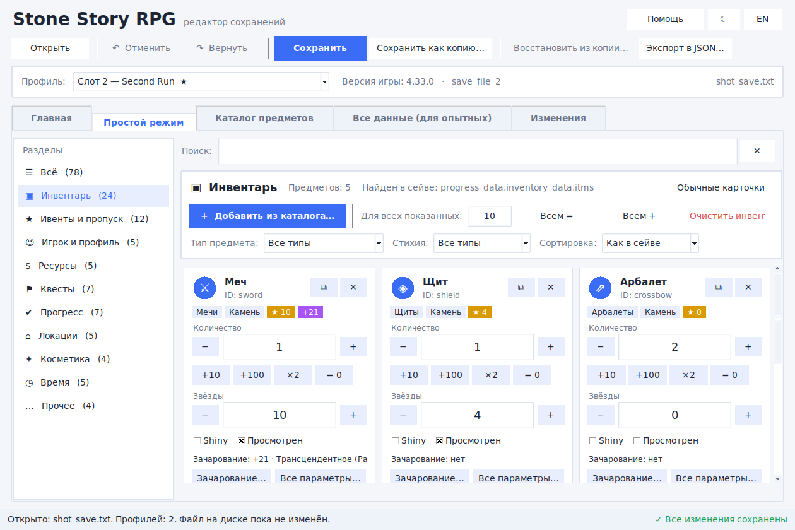
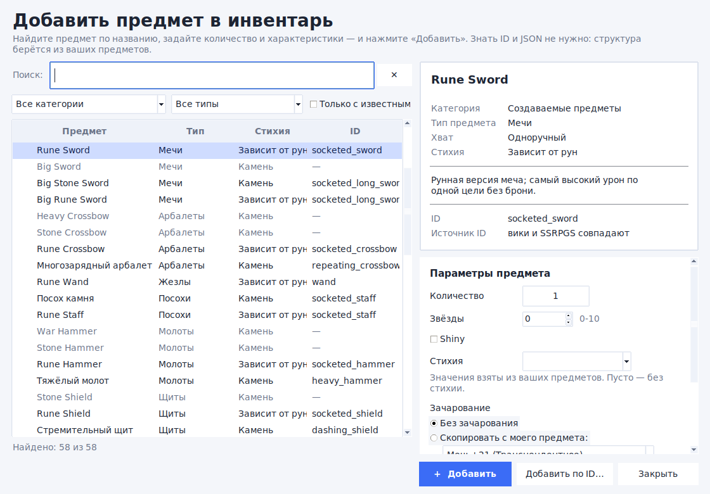

<details>
<summary>Ещё скриншоты (карточки, тёмная тема, список, стартовый экран)</summary>

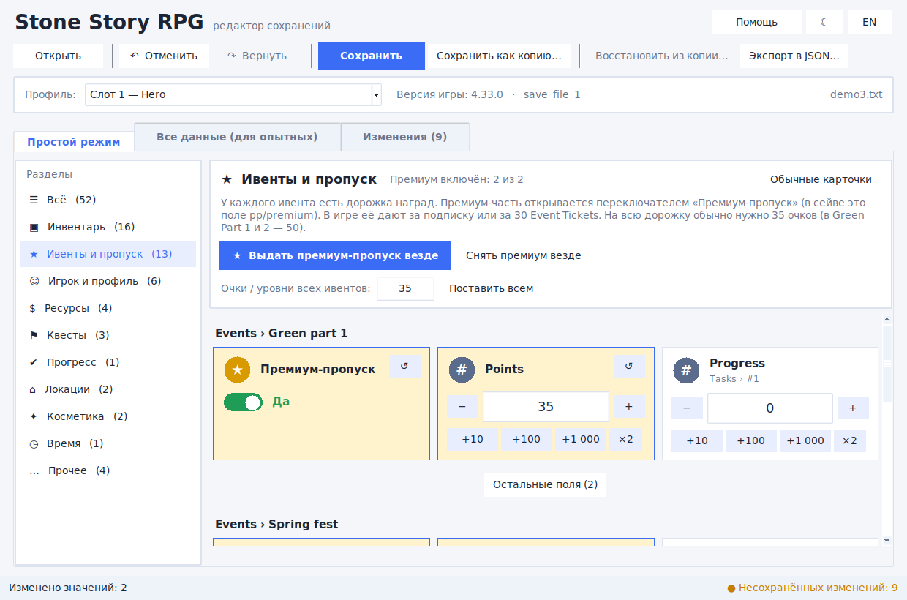
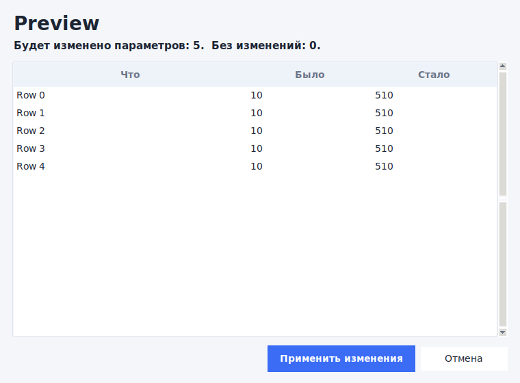
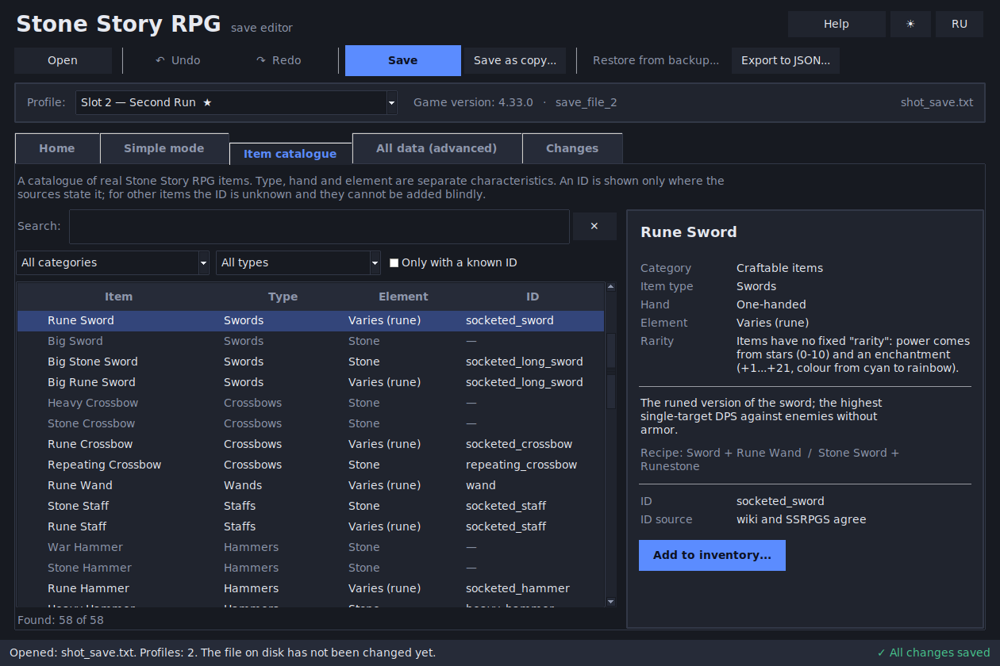
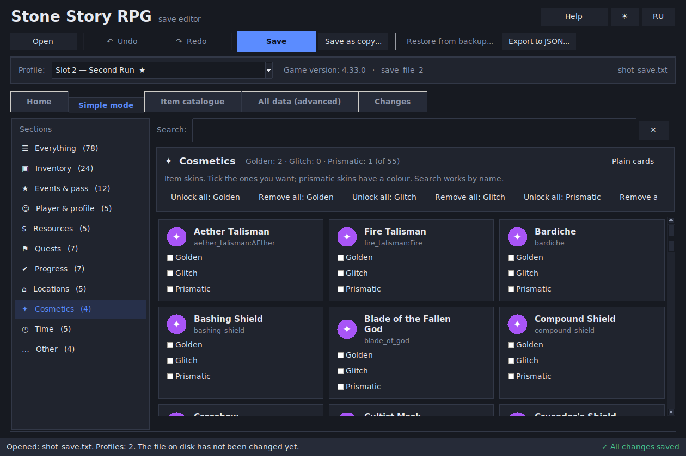
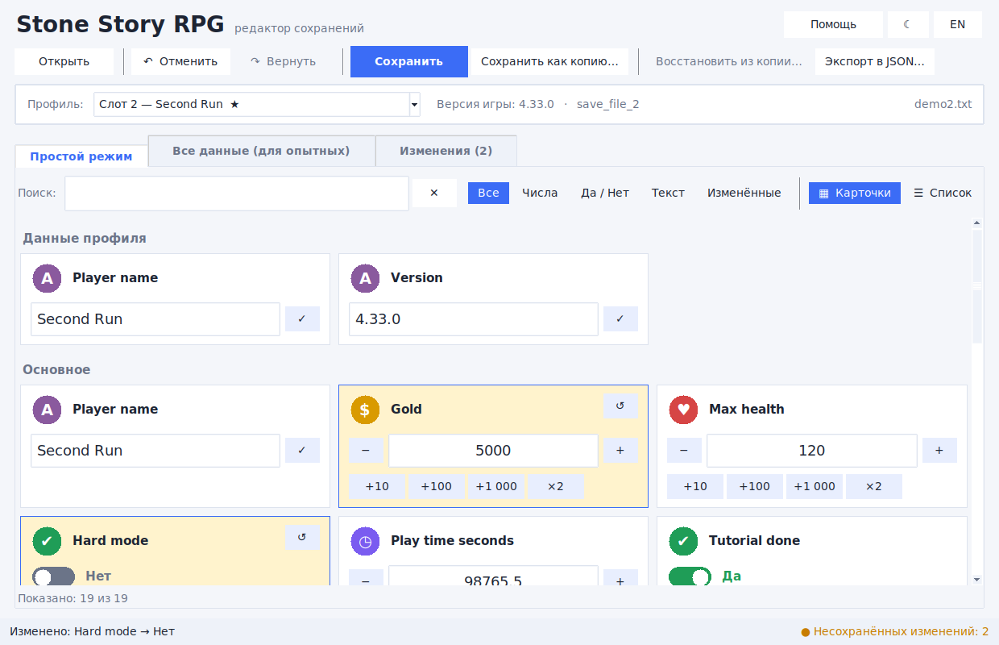
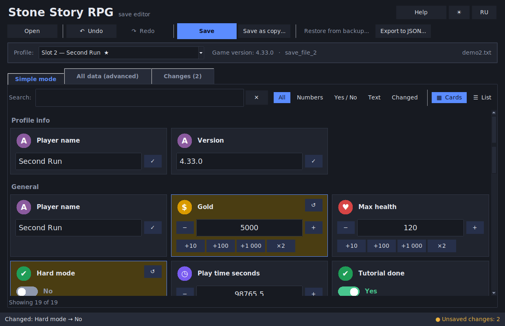
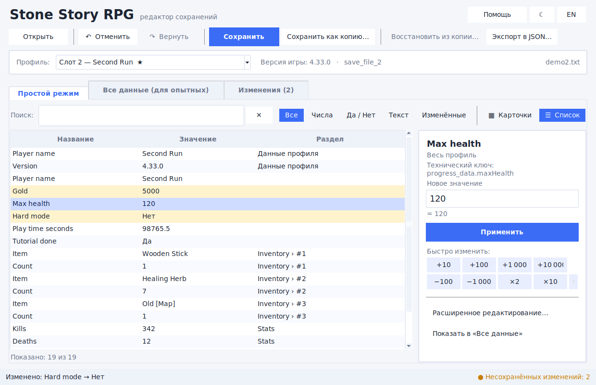
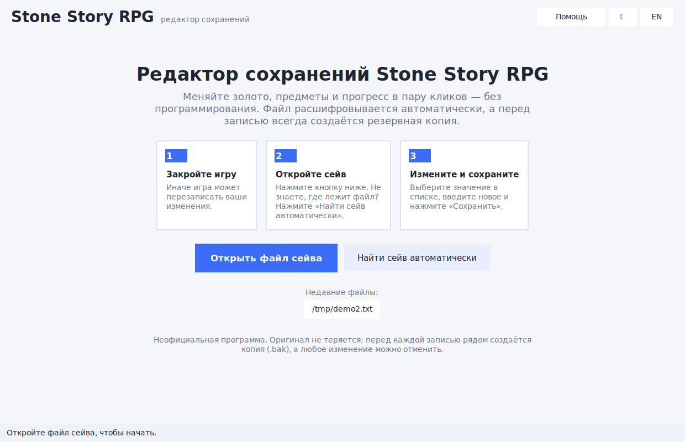

*На скриншотах — выдуманный демонстрационный сейв.*
</details>

## Возможности

- **Главная** – девять плиток: Инвентарь, Ресурсы, Косметика, Игрок, Квесты, Ивенты, Прогресс, Локации и Каталог предметов.
- **Каталог предметов** – поиск реальных предметов Stone Story RPG по названию: категории, подкатегории, ID, описания и рецепты. Тип, хват, стихия, звёзды и зачарование — **отдельные** характеристики.
- **Добавление предметов без JSON** – выберите предмет по названию, задайте количество, звёзды, shiny, стихию и зачарование; структура копируется из ваших предметов. Предметы, ID которых нет в источниках, вслепую не добавляются.
- **Объяснения** – кнопка «?» у параметров игры (Level, XP, Shiny, Enchantments, Lost items, Premium pass ...). Неизвестные поля не угадываются.
- **Предпросмотр изменений** – перед массовым редактированием видно старые и новые значения и сколько параметров затронуто.
- **Разделы** – Инвентарь, Ивенты и пропуск, Игрок, Ресурсы, Квесты, Прогресс, Локации, Косметика, Время, Прочее. Выбираете раздел — видите только его значения.
- **Менеджер инвентаря** – карточка на каждый предмет: количество (`−` / `+`, быстрые `+10`, `+100`, `×2`), галочки (например *shiny*), поля звёзд и чар; добавить, скопировать, удалить предмет, изменить количество у всех показанных сразу, очистить инвентарь.
- **Ивенты и премиум-пропуск** – переключатель «Премиум-пропуск» (поле `pp`) у каждого ивента, кнопка **«Выдать премиум-пропуск везде»**, очки и уровни дорожки наград сразу для всех ивентов.
- **Карточки** – у каждого значения своя карточка: иконка, кнопки `−` / `+`, быстрые кнопки (`+10`, `+100`, `×2`) и переключатели Да/Нет.
- **Список** – таблица всех значений с панелью редактирования; можно выделить несколько чисел и изменить сразу все.
- **Поиск и фильтры** – числа, Да/Нет, текст, «только изменённые».
- **Безопасно** – перед каждой записью создаётся копия `.bak` с датой, результат расшифровывается и сверяется, файл пишется атомарно. Если проверка не прошла, ничего не записывается.
- **Отмена / повтор**, вкладка «Изменения» с возвратом по одному, «Восстановить из копии».
- **Автопоиск сейва**, список недавних файлов.
- **Светлая и тёмная тема**, интерфейс на русском и английском.
- Вкладка «Все данные (для опытных)»: полное дерево, добавление и удаление полей, правка JSON.

## Быстрый старт (Windows)

1. Установите [Python 3.10+](https://www.python.org/downloads/) и обязательно поставьте галочку **«Add Python to PATH»**.
2. Скачайте репозиторий (зелёная кнопка **Code → Download ZIP**) и распакуйте.
3. Дважды нажмите **`start.bat`**. При первом запуске установится одна небольшая библиотека (нужен интернет, один раз).
4. Закройте игру, нажмите **«Открыть файл сейва»** (или **«Найти сейв автоматически»**), измените значения и нажмите **«Сохранить»**.

Не хотите ставить Python? Скачайте `StoneStorySaveEditor.exe` на странице **Releases** (собирается через GitHub Actions).

### Linux / macOS

```bash
# только Linux: sudo apt install python3-tk
./start.sh
```

## Где лежит файл сейва?

Нажмите **«Найти сейв автоматически»**. По официальному FAQ игры файл `primary_save.txt` лежит здесь:

- Windows: `C:\Users\<вы>\AppData\LocalLow\Martian Rex, Inc_\Stone Story\<steam id>\`
- macOS: `~/Library/Application Support/Martian Rex, Inc_/Stone Story/<steam id>/`
- Linux: `<папка Steam>/Stone Story RPG/saves/<steam id>/`

Там же игра хранит `backup.txt` и файлы `historical_#`.

## Точность данных

Каталог, названия и подсказки используют только опубликованные источники (FAQ игры, вики сообщества, структура
сохранения, описанная проектом SSRPGS). У каждого ID указан источник; неизвестные ID остаются неизвестными.
Подробнее: [docs/DATA_SOURCES.md](docs/DATA_SOURCES.md).

## О разделах

Названия полей сейва нигде официально не описаны, поэтому разделы определяются по **ключевым словам**
(`inventory`, `event`, `pp`, `premium`, `quest` ...). Ничего не скрывается: неопознанное попадает в «Прочее», а кнопка
**«Обычные карточки»** на страницах Инвентаря и Ивентов показывает все значения раздела.
Если игра использует незнакомое слово, добавьте его в таблицу `RULES` в начале `stone_story_editor/sections.py`
(pull request с настоящими названиями ключей — отлично!).

## Важно

- **Закройте игру** перед сохранением, иначе она может перезаписать ваши изменения.
- Меняется только локальный файл. Покупки, подписки и данные, которые проверяет сервер, не выдаются.
- Очень большие числа (больше ~2 миллиардов) могут сломать игру — редактор предупредит.
- Не удаляйте `.bak`, пока не убедитесь, что игра загружает изменённый сейв.
- Неофициальная программа, **используйте на свой риск**. Не связана с разработчиками игры.
- Работает с актуальной версией игры (проверено на последнем релизе в Steam). Если будущее обновление изменит шифрование сейвов, редактор нужно будет обновить.
- Версия `pprp` намеренно зафиксирована на **0.2.6** — не обновляйте до 0.2.7.

## Для разработчиков

```bash
pip install -r requirements-dev.txt
python -m pytest
python tests/sample_save.py demo_save.txt   # выдуманный сейв для проверки
```

Чтобы выпустить релиз, создайте тег вида `v2.0.0` — workflow `.github/workflows/release.yml` соберёт и приложит `.exe`.

Структура сохранения и названия изучены по проекту [SSRPGS](https://github.com/Catalyst-42/SSRPGS) (только как справка, код не копировался) и вики сообщества.

Лицензия: [MIT](LICENSE).
